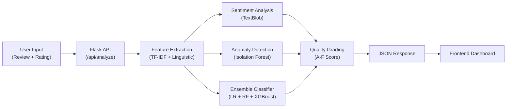

# 🛡️ ReviewGuard AI — System Walkthrough

## Fake Product Review Detection & Quality Grading System

> [!NOTE]
> The system is live at **http://localhost:5000** — paste any review and get instant analysis.

---

## Architecture Overview



---

## Project Structure

| File | Purpose |
|------|---------|
| [app.py](file:///c:/Users/Mahima/Desktop/project%20(ml)/app.py) | Flask backend with API endpoints & frontend serving |
| [feature_extraction.py](file:///c:/Users/Mahima/Desktop/project%20(ml)/ml_pipeline/feature_extraction.py) | TF-IDF vectorizer + handcrafted linguistic features |
| [sentiment_analysis.py](file:///c:/Users/Mahima/Desktop/project%20(ml)/ml_pipeline/sentiment_analysis.py) | Sentiment scoring & rating mismatch detection |
| [anomaly_detection.py](file:///c:/Users/Mahima/Desktop/project%20(ml)/ml_pipeline/anomaly_detection.py) | Isolation Forest anomaly detector |
| [ensemble_classifier.py](file:///c:/Users/Mahima/Desktop/project%20(ml)/ml_pipeline/ensemble_classifier.py) | LR + Random Forest + XGBoost ensemble |
| [quality_grading.py](file:///c:/Users/Mahima/Desktop/project%20(ml)/ml_pipeline/quality_grading.py) | A-F quality grade computation |
| [train.py](file:///c:/Users/Mahima/Desktop/project%20(ml)/ml_pipeline/train.py) | Training script with synthetic data generation |
| [index.html](file:///c:/Users/Mahima/Desktop/project%20(ml)/frontend/index.html) | Frontend HTML structure |
| [style.css](file:///c:/Users/Mahima/Desktop/project%20(ml)/frontend/style.css) | Dark mode design system (600+ lines) |
| [app.js](file:///c:/Users/Mahima/Desktop/project%20(ml)/frontend/app.js) | Frontend logic with animated gauges & API calls |

---

## ML Pipeline Components

### 1. Feature Extraction
- **TF-IDF**: 5000 features, bigrams, sublinear TF
- **Handcrafted**: 11 linguistic features (word count, caps ratio, lexical diversity, etc.)
- Combined into a 5011-dimensional feature vector

### 2. Sentiment Analysis
- TextBlob-based polarity (-1 to +1) and subjectivity (0 to 1)
- **Mismatch detection**: Compares sentiment polarity against expected polarity from star rating

### 3. Anomaly Detection
- Isolation Forest (200 estimators, 10% contamination)
- Flags statistically unusual review patterns

### 4. Ensemble Classification
- **Logistic Regression** (weight: 25%)
- **Random Forest** (weight: 35%)
- **XGBoost** (weight: 40%)
- Soft voting via weighted probability averaging

### 5. Quality Grading
| Weight | Component | Description |
|--------|-----------|-------------|
| 40% | Authenticity | Ensemble prediction probability |
| 20% | Sentiment Match | Inverse of sentiment-rating mismatch |
| 20% | Anomaly Safety | Inverse of anomaly score |
| 20% | Rating Score | Normalized star rating |

---

## API Endpoints

| Method | Endpoint | Description |
|--------|----------|-------------|
| GET | `/api/health` | Health check & model status |
| POST | `/api/analyze` | Analyze single review |
| POST | `/api/batch-analyze` | Analyze up to 50 reviews |

---

## Screenshots

````carousel

<!-- slide -->

````

---

## How to Run

```bash
# Install dependencies
pip install -r requirements.txt

# Train models (one-time)
python ml_pipeline/train.py

# Start the server
python app.py
# → Open http://localhost:5000
```

---

## Key Features
- ✅ **Paste-to-Analyze**: Pasting a review auto-triggers analysis
- ✅ **3 Example Buttons**: Authentic, Fake, and Suspicious pre-loaded reviews
- ✅ **Animated Gauge**: SVG arc gauge for authenticity probability
- ✅ **Model Breakdown**: See how each classifier voted
- ✅ **Quality Grade Badges**: A through F with color-coded display
- ✅ **Sentiment Bar**: Visual gradient with indicator dot
- ✅ **Anomaly Detection**: Pattern anomaly flagging with score
- ✅ **Text Feature Analysis**: 11 linguistic features displayed
